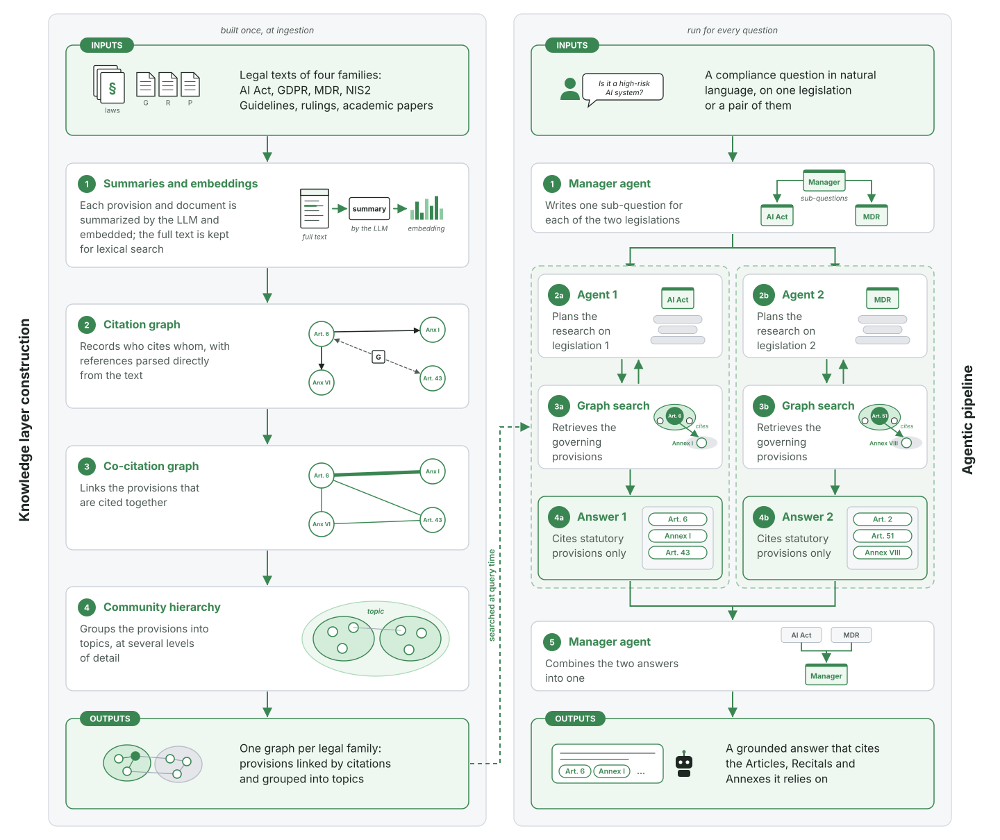
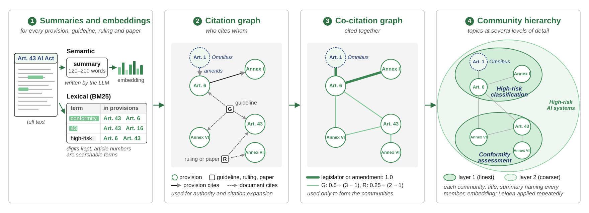
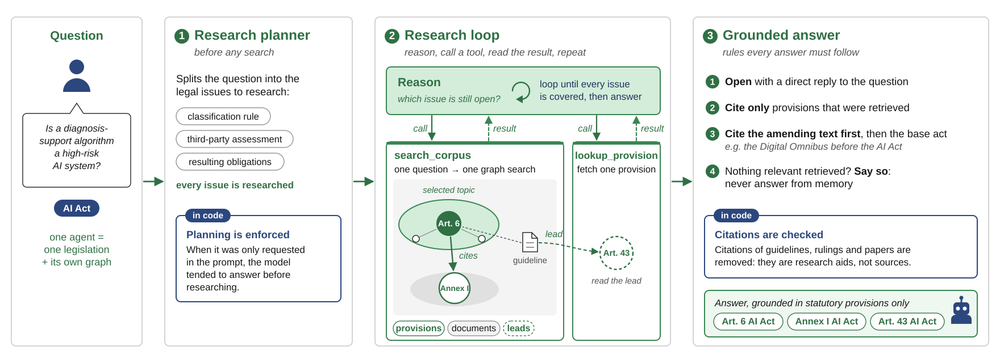
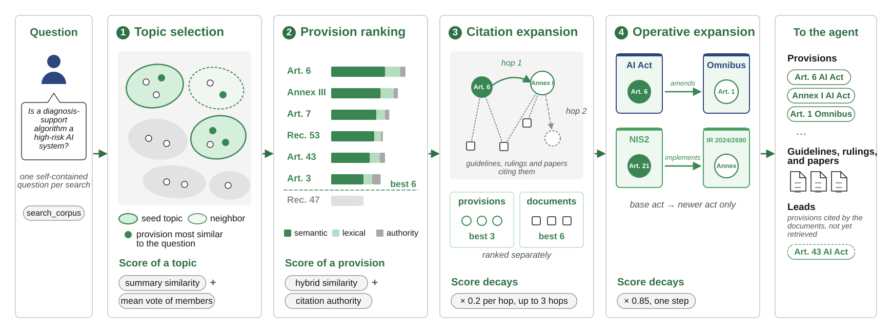
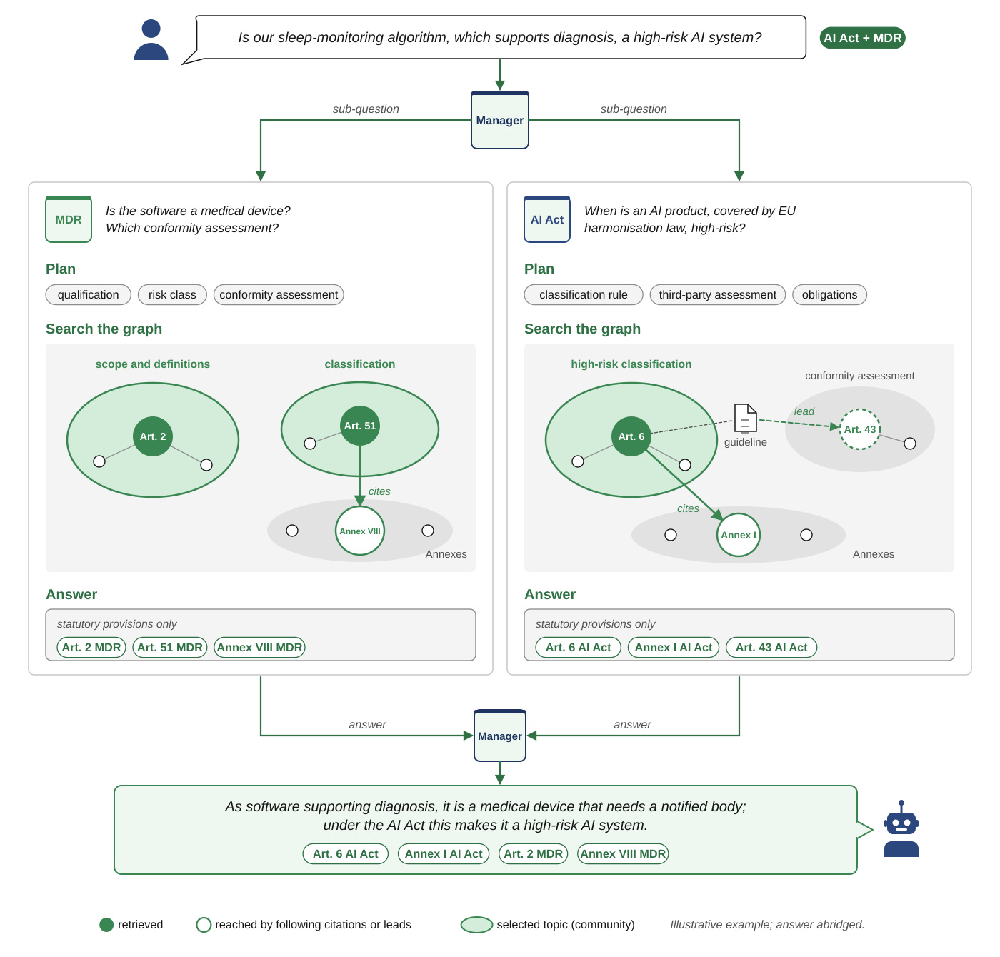

# WBPOA

**An assistant that reads the law before it answers.** WBPOA answers questions about the EU rules for medical robotics and AI. It draws on the AI Act, GDPR, MDR and NIS2, plus 1,686 guidelines, rulings and papers.

**The law** → **1. Build a map** of articles and their references, once → **2. Research** each question on the map, like a lawyer would → **An answer** that cites the articles it has actually read.

- **Grounded:** it may cite only what it has opened. If the law does not cover the case, it says so.
- **Two laws at once:** one specialist per law, and a coordinator for questions that cross them.
- **Private:** an open model on a private server, so questions and documents never leave it.

The model never has to *remember* the law: it only *reads* what the map hands it.



## Phase 1: the law becomes a map



1. **Summaries and embeddings.** Every provision, guideline, ruling and paper gets a 120–200 word summary written by the LLM, plus an embedding. A BM25 index over the full text covers lexical search. It keeps digits, so article numbers are searchable terms.
2. **Citation graph** (who cites whom). Provisions cite provisions, and documents cite provisions. It is used for authority and citation expansion.
3. **Co-citation graph** (cited together). Provisions linked by the legislator or an amendment get weight 1.0. A guideline citing *k* provisions adds 0.5 ÷ (*k* − 1) to each pair, and a ruling or paper adds 0.25 ÷ (*k* − 1). This graph is used only to form the communities.
4. **Community hierarchy.** Leiden is applied repeatedly, which gives topics at several levels of detail. Each community has a title, a summary naming every member, and an embedding.

References are read by plain rules from the text, never guessed by the model. The topics are the map's neighbourhoods, and each question starts from one.

## Phase 2: each question is researched like a lawyer would

1. **Plan.** Split the question into its legal issues. For example: is it a medical device? Is the AI high-risk? Which data rules apply?
2. **Search the map.** Find the right topic, open the articles and follow their references. Repeat until nothing is missing.
3. **Two laws, two specialists.** One assistant per law does the research. A coordinator splits the question and merges the two answers.
4. **Answer with sources.** It may cite only articles it has actually read. If the law does not cover the case, it says so.

**One agent per law.** It plans the issues before any search, loops through search and lookup until every issue is covered, and answers from statutory provisions only.



**One graph search.** The search selects topics, ranks the provisions in them, then follows citations and amending or implementing acts.



**Two laws together.** A worked example: *"Is our sleep-monitoring algorithm, which supports diagnosis, a high-risk AI system?"*, answered over the AI Act and the MDR.



## Does it work?

The test set has 453 questions written with legal experts, across the four laws and their pairings. Four legal experts rated 175 of the answers blind, on a 1–5 scale.

- **Correctness:** 4.36 / 5 on average. 87 % of answers were rated correct, 83 % complete and 75 % to the point (4 or 5 out of 5).
- **Two laws hold up:** two-law answers were rated complete 81 % of the time, against 85 % for one law.
- **Finding the law:** 72 % of the needed articles reach the model. Broad NIS2 questions are the hardest.
- **Self-grading:** an AI judge agrees only moderately with the experts, so human review stays in the loop.

**How to read the table:**
- **Recall:** the share of the expected provisions that the search hands to the agent.
- **Precision:** the share of the handed provisions that were expected. It is low by design, because the agent gets a wide context and picks from it.
- **Macro and micro:** macro averages over questions; micro pools all provisions.
- **Expert ratings:** the mean on the 1–5 scale, with the share rated 4 or 5 in brackets.

| Configuration | Recall macro | Recall micro | Precision macro | Precision micro | Completeness | Correctness | Relevance |
|---|---|---|---|---|---|---|---|
| AI Act | 0.655 | 0.587 | 0.113 | 0.104 | 4.03 (75%) | 4.22 (80%) | 4.29 (75%) |
| GDPR | 0.790 | 0.757 | 0.112 | 0.117 | 4.53 (85%) | 4.75 (100%) | 4.23 (85%) |
| MDR | 0.756 | 0.583 | 0.158 | 0.155 | 4.28 (85%) | 4.20 (85%) | 4.12 (70%) |
| NIS2 | 0.697 | 0.433 | 0.095 | 0.092 | 4.70 (95%) | 4.70 (100%) | 3.60 (45%) |
| AI Act + GDPR | 0.713 | 0.647 | 0.080 | 0.076 | 4.05 (70%) | 4.40 (80%) | 4.33 (70%) |
| AI Act + MDR | 0.766 | 0.760 | 0.070 | 0.068 | 3.80 (80%) | 3.75 (80%) | 4.15 (85%) |
| AI Act + NIS2 | 0.657 | 0.611 | 0.065 | 0.061 | 4.35 (85%) | 4.60 (90%) | 4.40 (75%) |
| GDPR + NIS2 | 0.642 | 0.653 | 0.047 | 0.042 | 4.00 (76%) | 3.88 (71%) | 4.00 (71%) |
| MDR + NIS2 | 0.684 | 0.582 | 0.052 | 0.052 | 4.67 (94%) | 4.72 (94%) | 4.94 (100%) |
| Single legislations | 0.730 | 0.598 | 0.124 | 0.122 | 4.38 (85%) | 4.47 (91%) | 4.06 (69%) |
| Pairings | 0.706 | 0.666 | 0.065 | 0.062 | 4.17 (81%) | 4.27 (83%) | 4.36 (80%) |
| **All** | **0.724** | **0.619** | **0.109** | **0.093** | **4.27 (83%)** | **4.36 (87%)** | **4.23 (75%)** |

## Setup

Requires Python 3.14, [uv](https://docs.astral.sh/uv/), Neo4j with Graph Data Science, and an OpenAI-compatible LLM endpoint.

```sh
uv sync
```

Create a `.env` with at least `NEO4J_PASSWORD`, plus `LLM_BASE_URL`, `LLM_MODEL` and `LLM_API_KEY`. Ingestion also needs `ZOTERO_API_KEY`. Optional: `NEO4J_URL`, `EMBED_MODEL`, `VLM_*`, `SUMMARIZER_*`, `LANGFUSE_*`, `HF_TOKEN`. Every option is in the `*settings.py` modules under `src/wbpoa/`.

## Corpora

1. Copy `data/corpora/corpus.example.toml` to `data/corpora/<key>/corpus.toml` and fill it in.
2. For cross-corpus questions, copy `data/multi-corpora/multi_corpora.example.toml` to `data/multi-corpora/<key>/multi_corpora.toml`.

## Usage

```sh
uv run wbpoa-ingest --corpus <key>                          # build the map (or --all)
uv run wbpoa-query "question" --corpus <key>                # retrieval only
uv run wbpoa-answer "question" --corpus <key>               # single-corpus answer
uv run wbpoa-multi-answer "question" --multi-corpora <key>  # cross-corpus answer
uv run wbpoa-ui                                             # web UI on http://127.0.0.1:8080
```

Each command takes `--help`.

## Funding

Developed within the Fit4MedRob Initiative (PNC0000007), funded by the Italian
Ministry of University and Research (MUR) under the Piano Nazionale
Complementare al PNRR.

## License

Licensed under the [Apache License 2.0](LICENSE). See [NOTICE](NOTICE).
